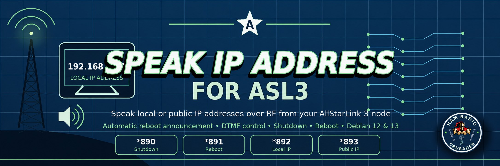

<p align="center">
  
</p>

# Speak-IP-Address-for-ASL3
Make your AllStarLink Node speak it's Local IP address on reboot
## Version 1.0.11

Supports ASL3 on Debian 12 (Bookworm) and Debian 13 (Trixie).
Adds `*894` to disconnect all linked nodes using ASL3's native `ilink,6`
function; no external disconnect helper is needed. Commands `*890` through
`*893` retain their existing behavior.

## Installation Instructions

First it's alway good to start at the profile root directory
```
cd ~
```

Then we need to download the installation script file
```
sudo wget https://raw.githubusercontent.com/KD5FMU/Speak-IP-Address-for-ASL3/refs/heads/main/install-speakip-v1.0.11.sh
```
Then we need to make it executable
```
sudo chmod +x install-speakip-v1.0.11.sh
```
Then execute the installer script
```
sudo ./install-speakip-v1.0.11.sh
```
Once you run the script installer it will ask for your Node number for the node it is being installed on. Once the script installer is finished it will ask if you want to play the local IP and you can answer yes or no
<br>
Once fininshed every time you reboot your node will play your local IP address over RF. And now you can play the local IP or the Public IP address at will with DTMF commands, AND you will have the ability to reboot or shutdown your node with two different DTMF commands listed here:<br>
<br>
  *890 = Shutdown AllStar Node<br>
  *891 = Reboot AllStar Node<br>
  *892 = Speak Local IP address<br>
  *893 = Speak Public IP address<br>
  *894 = Disconnect all linked nodes (native ASL3 `ilink,6`)<br>
<br>
If your AllScan Dashboard lost access ro rpt.conf from the last version then you can download this latest version installer script and run it like this to fix your current install without having to do it all over again.
```
sudo ./install-speakip-v1.0.11.sh --repair-rptconf-permissions
```
<br>


## Last but not least you may need to make this slight modification to /etc/asterisk/rpt.conf

<br>
I hope you get some use from this setup
73 and Ham On Y'all!!


## Upgrade and uninstall

To upgrade from v1.0.10, download and run the v1.0.11 installer above and
enter the same node number. It backs up `rpt.conf`, replaces the Speak IP
entries, and adds `894 = ilink,6` to `[functions]`, including inherited
`[functions](functions-main)` stanzas. Re-running the installer does not
duplicate its command entries. Installation restarts Asterisk.

The installer checks commands 890–894 before installing packages or helpers
and refuses to overwrite conflicting definitions, including conflicts hidden
by duplicate entries. Resolve any reported conflicts in `rpt.conf` first.
Legacy Speak IP commands 990–993 are cleaned up during installation and removal.

Use the **v1.0.11** installer to uninstall so the new 894 entry is also removed:

```bash
sudo ./install-speakip-v1.0.11.sh --uninstall
```

Uninstall removes the exact Speak IP command entries (including `894 = ilink,6`)
and helpers, preserves unrelated commands, and leaves `asl3-tts` installed.
The permissions repair options only repair permissions; run the full installer
to add `*894`.

## Development validation

```bash
bash -n install-speakip-v1.0.11.sh
python3 -m unittest discover -s tests -v
```

The tests use temporary configuration files without installing packages,
restarting Asterisk, or issuing radio commands. On an ASL3 node, verify that
`*890`–`*893` retain their behavior and, with test links established, that
`*894` disconnects all linked nodes.
